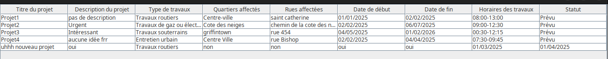

# Feedback DM3

## Application

### Résidents

- Je n'ai absolument pas compris comment la planification participative fonctionne.
- Quand un nouveau projet est soumis par un intervenant, il est affiché comme ça dans l'affichage des projets:

- Le résident ne reçoit pas de notification quand un intervenant pose une candidature pour sa requête de travail.

### Intervenants

- Il n'y a pas d'avertissement de conflits d'horaire quand un nouveau projet proposé empiète sur les horaires d'un résident. 

### Spécifications

Tout est bon!

## Code

Pourquoi le code n'est pas sur GitHub? 

- Le code est bien fait, lisible et documenté, mais il n'est juste pas assez subdivisé en packages comme le package `code` dans lequel vous avez mis 3 classes.

## Tests unitaires

- Tous les tests passent!
- Très original le fait de tester séparément la logique et l'UI!
- Par contre on a aussi demandé un rapport de tests avec JaCoCo. Il est absent.

## Documentation

- Le readme ne donne pas d'identifiants pour se connecter directement avec un utilisateur par rôle.
- Il semble qu'il n'y ait pas d'annotation additionnelle dans le JavaDoc concernant les auteurs, la version ou la date.

## Configuration Maven

Les tests ne se lancent pas quand j'exécute la commande `mvn clean verify` ou `mvn cleean test`.

## Démonstration

- Bien mais vous n'avez pas parlé de l'architecture de l'application.

## BONUS: GUI

Bien!